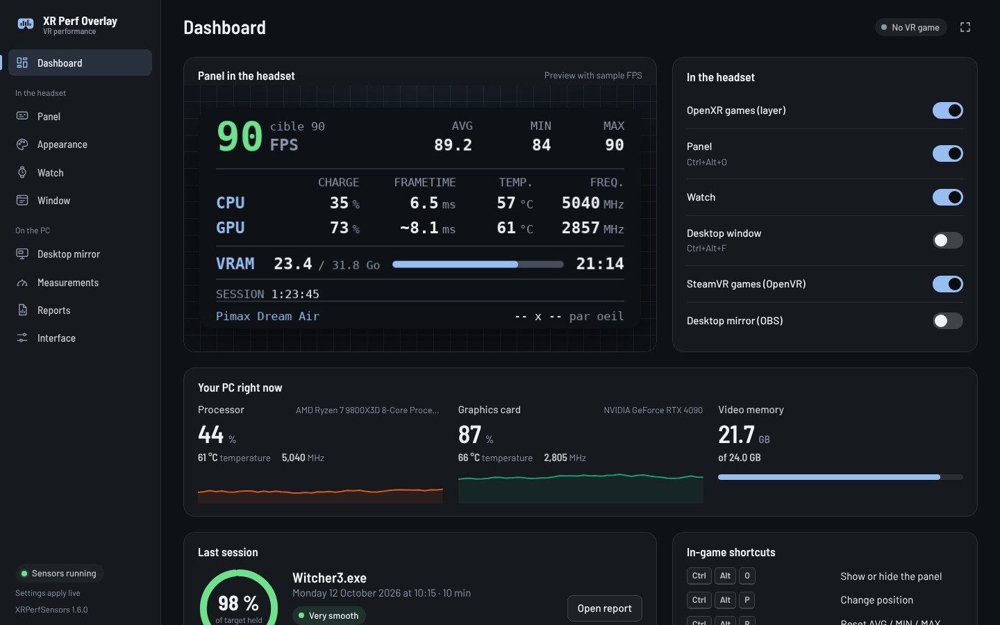
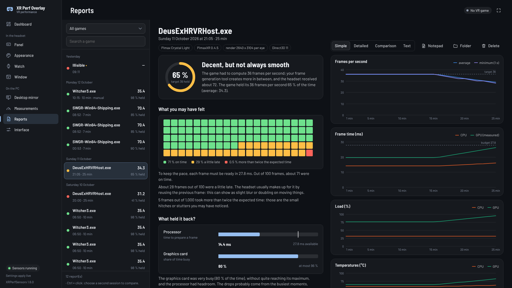

# XR Perf Overlay

*Français : [README.md](README.md)*

A performance panel shown in the headset for every OpenXR game (including games run with UEVR), and also for SteamVR games that don't go through OpenXR (OpenVR):

- **FPS**: instantaneous, average (AVG), minimum and maximum
- **CPU**: load, frame time, temperature, clock
- **GPU**: load, frame time, temperature, clock, VRAM

Optional: a wrist watch, and a desktop window (a stream chat, Discord...) shown in the headset. A report is written for every game session (or on the `Ctrl+Alt+S` hotkey), with its analysis and curves.

Everything is set in the XRPerfSensors window, even mid-game:

It uses OpenXR's official mechanism: nothing is injected into the game, no Direct3D function is hooked. It works alongside UEVR, OFXR Bridge and other mods.

## Installation

1. Download `XRPerfOverlay-<version>-win64.zip` from the [latest release](../../releases/latest).
2. Extract the whole archive (right-click, "Extract All").
3. Double-click **`Installer.bat`**.
   - Windows may show "Windows protected your PC": the program isn't signed. Click "More info", then "Run anyway".
   - Accept the administrator permission request: it is needed to declare the layer to OpenXR.
4. Choose whether XRPerfSensors (the program that reads the sensors) starts with Windows.

The program is installed in `C:\XRPerfOverlay`. To **update**, do the same: your settings and reports are kept. The extracted folder can be deleted afterwards.

**What you need**: Windows 10 or 11, 64-bit, and an OpenXR game in Direct3D 11 or 12, or a SteamVR game. Nothing else to install: the .NET runtime is included, and the window's WebView2 engine already comes with Windows 11 and up-to-date Windows 10.

**Optional**: the [PawnIO](https://pawnio.eu/) driver, for the processor's temperature and clock (`winget install namazso.PawnIO`). Without it, these two values show `--`.

**With UEVR**, choose **OpenXR** as the runtime in the injector.

**Uninstalling**: run `uninstall.bat` in `C:\XRPerfOverlay`, then delete that folder.

## Usage

Start a VR game: the panel appears in the headset. Double-click the XRPerfSensors icon near the clock to open its window (settings, reports).

| Shortcut | Action |
|---|---|
| `Ctrl + Alt + O` | Show / hide the panel |
| `Ctrl + Alt + P` | Change position |
| `Ctrl + Alt + R` | Reset AVG / MIN / MAX |
| `Ctrl + Alt + Page Up` / `Page Down` | Enlarge / shrink the panel |
| `Ctrl + Alt + Home` / `End` | Panel more opaque / more transparent |
| `Ctrl + Alt + F` | Show / hide the desktop window |
| `Ctrl + Alt + G` | Place the desktop window in front of you |
| `Ctrl + Alt + S` | Manual report mode: start / stop recording |

## Learn more

- [User guide](docs/GUIDE.en.md): each page of the window, the watch, SteamVR games, reports, what each value measures, troubleshooting.
- [CHANGELOG](CHANGELOG.en.md): what's new in each version.
- [Development](docs/DEVELOPMENT.md): building from source, building the package, code layout.

MIT license ([LICENSE](LICENSE)). Third-party components: [THIRD-PARTY.md](THIRD-PARTY.md).
