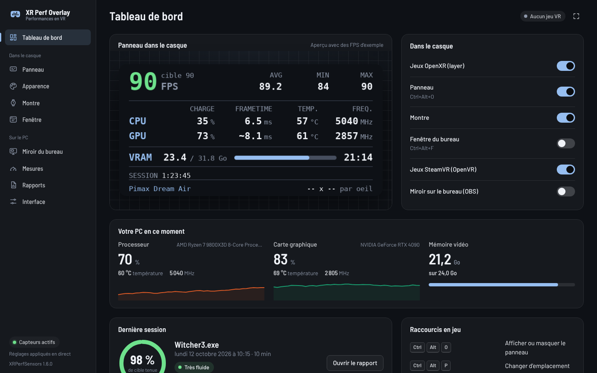
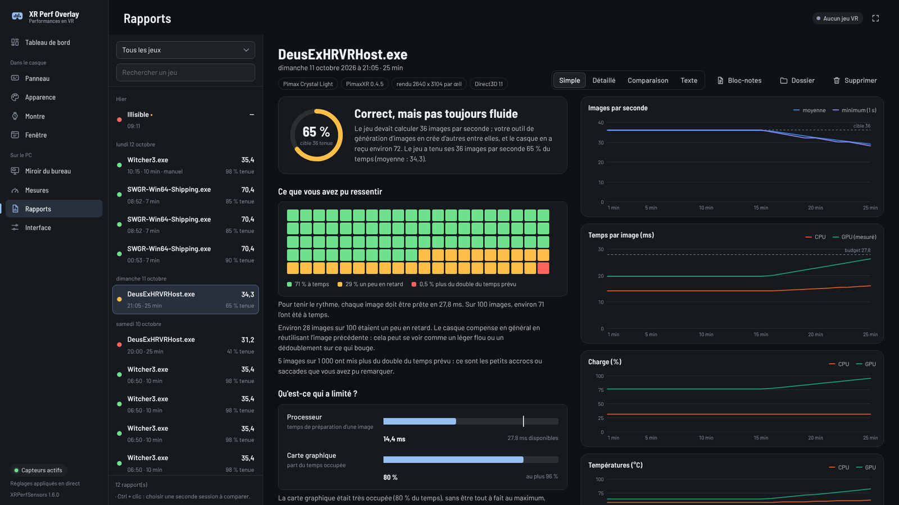

# XR Perf Overlay

*English: [README.en.md](README.en.md)*

Un panneau de performances affiché dans le casque pour tous les jeux OpenXR (dont les jeux lancés avec UEVR), et aussi pour les jeux SteamVR qui ne passent pas par OpenXR (OpenVR) :

- **FPS** instantané, moyenne (AVG), minimum et maximum
- **CPU** : charge, frametime, température, fréquence
- **GPU** : charge, frametime, température, fréquence, VRAM

En option : une montre au poignet, et une fenêtre du bureau (le chat d'un stream, Discord...) affichée dans le casque. Un rapport est écrit à chaque session de jeu (ou au raccourci `Ctrl+Alt+S`), avec son analyse et ses courbes. La page Configuration fait le diagnostic du PC pour la VR : runtime OpenXR, layers installées, matériel, réglages de Windows.

Tout se règle dans la fenêtre de XRPerfSensors, même en cours de partie :

Il passe par le mécanisme officiel d'OpenXR : rien n'est injecté dans le jeu, aucune fonction Direct3D n'est détournée. Il fonctionne aux côtés d'UEVR, d'OFXR Bridge et des autres mods.

## Installation

1. Téléchargez `XRPerfOverlay-<version>-win64.zip` dans la [dernière version](../../releases/latest).
2. Extrayez toute l'archive (clic droit, « Extraire tout »).
3. Double-cliquez sur **`Installer.bat`**.
   - Windows peut afficher « Windows a protégé votre ordinateur » : le programme n'est pas signé. Cliquez sur « Informations complémentaires », puis « Exécuter quand même ».
   - Acceptez la demande d'autorisation d'administrateur : elle sert à déclarer la layer auprès d'OpenXR.
4. Choisissez si XRPerfSensors (le programme qui lit les capteurs) démarre avec Windows.

Le programme s'installe dans `C:\XRPerfOverlay`. Pour une **mise à jour**, faites la même chose : vos réglages et vos rapports sont conservés. Le dossier extrait peut être supprimé ensuite.

**Ce qu'il faut** : Windows 10 ou 11, 64 bits, et un jeu OpenXR en Direct3D 11 ou 12, ou un jeu SteamVR. Rien d'autre à installer : le runtime .NET est inclus, et le moteur WebView2 de la fenêtre est déjà dans Windows 11 et Windows 10 à jour.

**Facultatif** : le pilote [PawnIO](https://pawnio.eu/), pour la température et la fréquence du processeur (`winget install namazso.PawnIO`). Sans lui, ces deux valeurs affichent `--`.

**Avec UEVR**, choisissez **OpenXR** comme runtime dans l'injecteur.

**Désinstallation** : lancez `uninstall.bat` dans `C:\XRPerfOverlay`, puis supprimez ce dossier.

## Utilisation

Lancez un jeu VR : le panneau apparaît dans le casque. Double-cliquez sur l'icône de XRPerfSensors près de l'horloge pour ouvrir sa fenêtre (réglages, rapports).

| Raccourci | Action |
|---|---|
| `Ctrl + Alt + O` | Afficher / masquer le panneau |
| `Ctrl + Alt + P` | Changer d'emplacement |
| `Ctrl + Alt + R` | Remettre à zéro AVG / MIN / MAX |
| `Ctrl + Alt + Page précédente` / `Page suivante` | Agrandir / réduire le panneau |
| `Ctrl + Alt + Début` / `Fin` | Panneau plus opaque / plus transparent |
| `Ctrl + Alt + F` | Afficher / masquer la fenêtre du bureau |
| `Ctrl + Alt + G` | Poser la fenêtre du bureau devant soi |
| `Ctrl + Alt + S` | Rapport en mode manuel : démarrer / arrêter l'enregistrement |

## En savoir plus

- [Guide d'utilisation](docs/GUIDE.md) : chaque page de la fenêtre, la montre, les jeux SteamVR, les rapports, ce que mesure chaque valeur, le dépannage.
- [CHANGELOG](CHANGELOG.md) : les nouveautés de chaque version.
- [Développement](docs/DEVELOPPEMENT.md) : compiler depuis les sources, construire le paquet, organisation du code.

Licence MIT ([LICENSE](LICENSE)). Composants tiers : [THIRD-PARTY.md](THIRD-PARTY.md).
