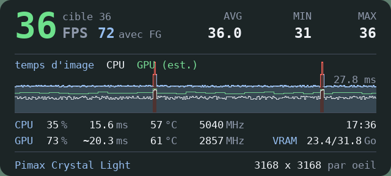
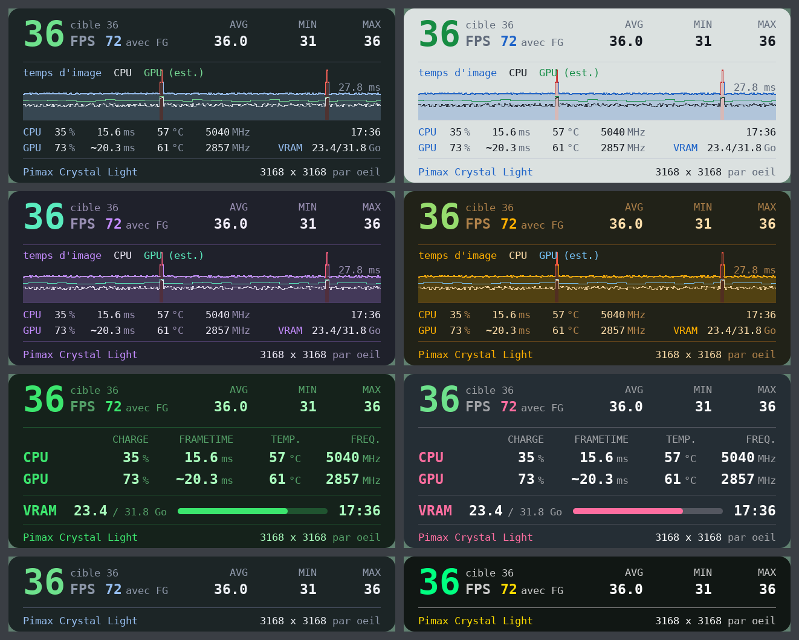
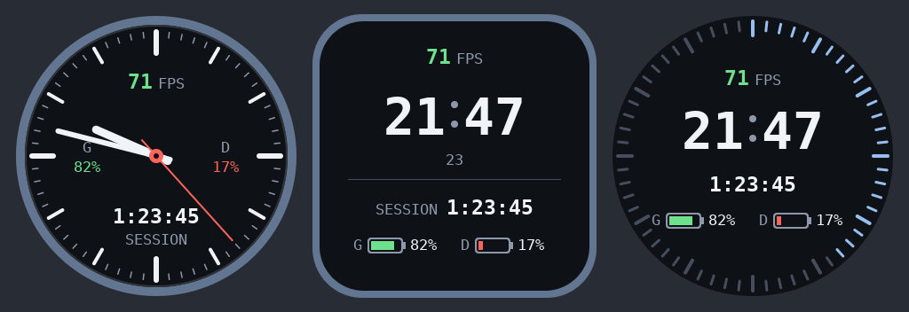

# XR Perf Overlay

Un panneau de performances affiché dans le casque pour tous les jeux OpenXR (dont les jeux lancés avec UEVR), et aussi pour les jeux SteamVR qui ne passent pas par OpenXR (OpenVR) :

- **FPS** instantané, moyenne (AVG), minimum et maximum
- **CPU** : charge, frametime, température, fréquence
- **GPU** : charge, frametime, température, fréquence, VRAM

En option : une montre au poignet, et une fenêtre du bureau (le chat d'un stream, Discord...) affichée dans le casque.



Le projet contient deux programmes :

| Dossier | Rôle |
|---|---|
| `layer/` | La *API layer* OpenXR (DLL C++) chargée dans le jeu : mesure les FPS et affiche le panneau. |
| `sensors/` | `XRPerfSensors.exe` (C#), lancé à part : lit les capteurs du PC et les transmet à la layer. |
| `layer/src/vr_*.cpp` | `XRPerfVR.exe` (C++), lancé par XRPerfSensors : panneau, montre et rapports dans les jeux SteamVR (OpenVR). |
| `layer/src/window_capture.cpp` | `XRPerfCapture.dll` (C++), chargée par XRPerfSensors : capture de la fenêtre affichée dans le casque. |

## Pourquoi ça ne gêne pas les mods

- La layer passe par le mécanisme officiel d'OpenXR (une DLL déclarée dans le registre, insérée par le chargeur entre le jeu et le runtime). Elle n'injecte rien, ne détourne aucune fonction Direct3D ou DXGI et ne crée pas de fenêtre. Par défaut, elle ne touche pas aux manettes ; seule l'accroche à une main (montre au poignet, panneau sur une main), si vous la choisissez, y ajoute la position des mains (voir « Montre et accroche aux manettes »).
- Elle n'intercepte que six fonctions OpenXR et n'en modifie qu'une : à `xrEndFrame`, elle ajoute **un calque rectangulaire à la fin** de la liste envoyée par le jeu (deux si la montre est affichée). Les images, les poses et les réglages du jeu ou d'UEVR passent tels quels. Une image que le jeu soumet vide (chargement) reste vide.
- Le seul appel graphique est une copie du panneau (640 × 320 pixels au plus, quatre fois par seconde) vers une texture qui appartient à la layer. Aucun état de rendu du jeu n'est lu ni modifié. Le dessin du panneau se fait en mémoire et coûte de l'ordre d'un dixième de milliseconde par mise à jour. Seule exception, et seulement si vous l'activez : la mesure réelle du temps GPU ajoute deux horodatages par image au travail GPU du jeu (voir « Temps GPU : estimation ou mesure »).
- Si le runtime refuse une image à cause de notre calque, la layer la renvoie aussitôt sans lui ; au troisième refus elle se désactive pour la session. Au moindre problème de son côté, elle s'efface.
- Les capteurs sont lus dans un programme séparé : rien de risqué (pilote, accès matériel) ne tourne dans le jeu.

## Deux façons de l'obtenir

- **Paquet de distribution** (`XRPerfOverlay-<version>-win64.zip`, page « Releases » du dépôt) : le programme déjà compilé. Rien à installer à part lui : ni Visual Studio, ni SDK, ni runtime .NET (inclus). Extraire l'archive, double-cliquer sur `Installer.bat`. Le fichier `LISEZ-MOI.txt` du paquet guide l'utilisateur.
- **Sources** (ce dépôt) : `Installer.bat` compile d'abord, ce qui demande les outils ci-dessous.

Dans les deux cas, le pilote PawnIO est facultatif (température et fréquence du processeur seulement).

## Prérequis (compilation depuis les sources)

- Windows 10 ou 11, 64 bits
- Visual Studio 2022 (ou plus récent) avec les charges **« Développement Desktop en C++ »** et **« Développement .NET Desktop »**
  (à défaut de la seconde, le SDK .NET seul suffit : `winget install Microsoft.DotNet.SDK.10`). Sans SDK .NET, `build.bat` compile quand même la layer, mais `Installer.bat` s'arrête : il n'installe que l'ensemble complet.
- Pour la température et la fréquence du **processeur** : le pilote **PawnIO**, à installer une fois (`winget install namazso.PawnIO`, ou https://pawnio.eu). C'est le pilote qu'utilise LibreHardwareMonitor depuis sa version 0.9.5. Sans lui, tout le reste fonctionne et ces deux valeurs affichent `--`.
- Une connexion internet à la première compilation (NuGet télécharge LibreHardwareMonitorLib).

## Installation et mise à jour

Extraire toute l'archive (dans Téléchargements, par exemple), puis double-cliquer sur **`Installer.bat`**. C'est la seule manipulation, pour une première installation comme pour une mise à jour. Si Windows affiche un avertissement parce que le fichier vient d'internet, choisir « Informations complémentaires » puis « Exécuter quand même ».

1. depuis les sources, il compile la layer et le programme de capteurs (une à deux minutes) ; depuis le paquet de distribution, il n'y a rien à compiler ;
2. Windows demande une autorisation d'administrateur, nécessaire pour déclarer la layer à OpenXR (`HKLM\SOFTWARE\Khronos\OpenXR\1\ApiLayers\Implicit`) ;
3. les fichiers sont copiés dans le dossier d'installation, la layer est enregistrée et `XRPerfSensors` est relancé.

Le dossier d'installation est celui de l'installation existante s'il y en a une (celle enregistrée auprès d'OpenXR, ou à défaut celle trouvée dans `C:\XRPerfOverlay` ou `C:\XRPerfOverlay\dist`), sinon `C:\XRPerfOverlay`. Lors d'une mise à jour, vos réglages (`XRPerfOverlay.ini`) et vos résumés de session (`sessions\`) sont conservés ; le fichier `XRPerfOverlay.defaut.ini` posé à côté montre les options de la nouvelle version. Le sous-dossier `sensors\` est remplacé en entier. À la première installation, l'installateur demande si `XRPerfSensors` doit démarrer avec Windows.

`XRPerfSensors` peut rester lancé : l'installateur l'arrête puis le relance. Avant de lancer `Installer.bat`, fermer en revanche le jeu VR en cours : tant qu'un jeu OpenXR est ouvert, l'ancienne DLL ne peut pas être remplacée, et l'installateur s'arrête sans rien modifier. Si la compilation échoue, rien n'est installé non plus ; le détail est dans `build.log`.

Une fois l'installation faite, le dossier extrait (et l'archive) peuvent être supprimés. Seule exception : si l'archive a été extraite à l'emplacement même de l'installation par défaut (`C:\XRPerfOverlay`), le programme est rangé dans son sous-dossier `dist\` et l'installateur le signale ; il faut alors garder ce dossier.

Options, depuis une invite de commandes : `Installer.bat -Target "D:\Outils\XRPerfOverlay"` pour choisir le dossier (sans `\` à la fin ; les réglages d'une installation existante y sont repris), `-AutoStart oui` ou `-AutoStart non` pour ne pas avoir la question.

### À la main

`build.bat` compile seulement et rassemble le résultat dans `dist\` :

```
dist\
  XR_APILAYER_NOVENDOR_perf_overlay.dll    la layer
  XR_APILAYER_NOVENDOR_perf_overlay.json   sa déclaration pour OpenXR
  XRPerfOverlay.ini                        les réglages
  install.bat / uninstall.bat
  sensors\                                 le programme de capteurs (XRPerfSensors.exe et ses bibliothèques)
```

Ce dossier `dist\` se copie tel quel (y compris **son** sous-dossier `sensors\`, à ne pas confondre avec le dossier `sensors\` des sources, à côté de `build.bat`) à l'emplacement voulu, de préférence un dossier où vous avez le droit d'écrire, pour que les raccourcis puissent mémoriser leur état dans le `.ini`. `install.bat` y enregistre la layer ; `install.bat -AutoStartSensors` fait en plus démarrer `XRPerfSensors` à l'ouverture de session, sans invite UAC. Sans cela, lancer `sensors\XRPerfSensors.exe` avant de jouer (icône dans la zone de notification, clic droit → Quitter).

Avec UEVR, choisir **OpenXR** comme runtime dans l'injecteur : en mode OpenVR, le jeu ne passe pas par OpenXR et la layer n'est pas chargée.

Désinstallation : `uninstall.bat` dans le dossier d'installation, puis supprimer ce dossier.

## Version et distribution

**Numéro de version.** Il est écrit à un seul endroit, le fichier `VERSION` à la racine (forme `1.2.3`). La compilation le reporte partout : ressource de version de la DLL (propriétés du fichier, onglet Détails), XRPerfSensors (titre des fenêtres, menu et info-bulle de l'icône), journal de la layer (ligne « Instance OpenXR créée »), en-tête de chaque rapport de session, et fichier `VERSION` du dossier d'installation. Si la DLL et XRPerfSensors installés ne viennent pas de la même version, XRPerfSensors le signale au démarrage.

**Construire le paquet sur son PC.** Double-cliquer sur `Creer-paquet.bat` : il compile (comme `build.bat`), publie XRPerfSensors en mode autonome (runtime .NET inclus ; il faut Internet pour que NuGet le télécharge), puis produit `release\XRPerfOverlay-<version>-win64.zip` et son empreinte SHA-256. Le script `scripts\package.ps1` fait le travail ; il vérifie que la DLL porte bien le numéro du fichier `VERSION`, que XRPerfSensors est bien autonome et que le paquet contient tout ce que l'installateur attend.

Contenu du paquet :

```
XRPerfOverlay-<version>\
  Installer.bat           installation ou mise à jour (rien à compiler)
  LISEZ-MOI.txt           guide de l'utilisateur
  README.md, docs\        cette documentation
  LICENSE.txt, THIRD-PARTY.md
  scripts\setup.ps1
  programme\              ce qui est copié dans le dossier d'installation (DLL, .json, .ini, VERSION,
                          install / uninstall, sensors\ avec le runtime .NET)
```

**Compilation automatique (GitHub Actions).** Une fois le projet sur GitHub, le fichier `.github/workflows/build.yml` compile la layer avec MSVC et XRPerfSensors sur une machine Windows à chaque envoi, lance les tests de `tests/preview.cpp`, construit le paquet avec Windows PowerShell 5.1 et le joint à l'exécution (onglet Actions, rubrique Artifacts). Pour publier une version : mettre le numéro dans `VERSION`, valider, puis `git tag v1.0.0` et `git push origin v1.0.0`. Le workflow vérifie que l'étiquette correspond au fichier `VERSION` et crée un **brouillon** de version avec le paquet : il reste à le relire et à le publier depuis la page « Releases ».

**Signature.** Les fichiers ne sont pas signés : Windows affiche « éditeur inconnu » au premier lancement de `Installer.bat`, ce que `LISEZ-MOI.txt` explique. L'installateur retire ensuite la marque « provenant d'Internet » des fichiers installés, pour que XRPerfSensors ne redemande pas de confirmation à chaque lancement.

**Licence.** Le code du projet est sous licence MIT (`LICENSE`). Les composants tiers et leurs licences sont dans `THIRD-PARTY.md`.

## Utilisation

| Raccourci | Action |
|---|---|
| `Ctrl + Alt + O` | Afficher / masquer le panneau |
| `Ctrl + Alt + P` | Changer d'emplacement (les quatre coins, haut, bas) |
| `Ctrl + Alt + R` | Remettre à zéro AVG / MIN / MAX |
| `Ctrl + Alt + Page précédente` / `Page suivante` | Agrandir / réduire le panneau (maintenir pour continuer) |
| `Ctrl + Alt + Début` / `Fin` | Panneau plus opaque / plus transparent, texte compris (maintenir pour continuer) |
| `Ctrl + Alt + F` | Afficher / masquer la fenêtre capturée |
| `Ctrl + Alt + G` | Poser la fenêtre capturée devant soi, là où l'on regarde |

Les raccourcis fonctionnent même si la fenêtre du jeu n'a pas le focus, et les réglages faits en jeu (affichage, emplacement, taille, opacité) sont mémorisés dans `XRPerfOverlay.ini`. Ce fichier commenté permet aussi de régler la fréquence de mise à jour, les touches et la liste de programmes à ignorer.

## Réglages

Double-cliquer sur l'icône `XRPerfSensors` près de l'horloge (ou clic droit → **Réglages...**) ouvre la fenêtre de réglages. Chaque changement s'applique tout de suite, y compris dans un jeu en cours, et il est enregistré dans `XRPerfOverlay.ini`.

- **Dans le casque** : afficher ou masquer le panneau, emplacement (quatre coins, haut, bas), taille, opacité de l'ensemble, opacité du fond seul, distance devant les yeux, écarts horizontal et vertical, orientation vers les yeux ; ou bien accroche à une main (gauche ou droite), emplacement sur la main, affichage seulement quand on regarde sa main, ajustements de position.
- **Apparence** (casque et bureau) : présentation, couleurs, heure, ligne casque / résolution, ligne session / batterie (temps de session et batterie des manettes, en option).
- **Montre** : afficher la montre, main ou vue, emplacement sur la main, style, éléments, affichage au regard, taille, opacité, ajustements de position, avec un aperçu (voir « Montre et accroche aux manettes »).
- **Sur le bureau** : afficher la fenêtre miroir, emplacement (libre ou contre un bord de l'écran), taille, opacité, premier plan.
- **Mesures et rapports** : mesure réelle du temps GPU (sinon estimation), écriture d'un rapport à chaque session, modèles du processeur et de la carte graphique dans les rapports, accès à la fenêtre des rapports. Ces options valent au prochain lancement d'un jeu.

Trois présentations :

| Présentation | Contenu |
|---|---|
| Complète | FPS, AVG / MIN / MAX, tableau CPU / GPU (charge, frametime, température, fréquence), VRAM avec jauge. |
| Graphique | FPS, AVG / MIN / MAX, courbe du temps d'image des dix dernières secondes, puis CPU et GPU sur deux lignes. |
| Compacte | FPS, AVG / MIN / MAX seulement. |

Dans la présentation graphique, la courbe colorée est le temps entre deux images du jeu (plus bas = plus rapide), le trait fin clair le temps CPU et le trait fin de couleur le temps GPU. Les pointillés marquent le budget d'une image, c'est-à-dire la durée à ne pas dépasser pour tenir la cible (13,9 ms à 72 Hz, 27,8 ms quand une génération d'images bride le jeu à 36) ; la courbe passe au rouge quand elle le dépasse. La légende indique « GPU (est.) » quand le trait GPU est l'estimation : il avance alors par paliers, une valeur par rafraîchissement du panneau. Avec la mesure réelle, il suit chaque image.

Six jeux de couleurs sont proposés (sombre, clair, contraste élevé, vert, ambre, violet), plus un jeu personnalisé dont on choisit le fond, le texte et l'accent.



**Aperçu sans jeu.** Quand la fenêtre du bureau est affichée et qu'aucun jeu OpenXR ne tourne, elle montre un aperçu : le panneau tel qu'il sera dans le casque, avec vos réglages et vos vrais capteurs, mais des FPS d'exemple (un bandeau « Aperçu » le rappelle sous l'image). L'aperçu est dessiné par la DLL de la layer elle-même, donc par le même code que dans le casque. Dès qu'un jeu démarre, la fenêtre affiche son panneau réel ; pendant un chargement, elle garde la dernière image du jeu, et l'aperçu ne revient qu'une fois le jeu fermé.

Les réglages faits dans la fenêtre et ceux faits en jeu au clavier se complètent : le dernier changement l'emporte, et la fenêtre relit le fichier chaque fois qu'elle revient au premier plan.

L'heure s'affiche en bas à droite du panneau (`clock=0` dans le `.ini` pour la retirer).

La dernière ligne du panneau donne le nom du casque et la résolution de rendu par œil (`headset_info=0` pour la retirer ; le panneau reprend alors sa hauteur d'origine). C'est la taille de l'image que le jeu envoie vraiment au casque. Quand elle s'écarte d'au moins 3 % de la résolution recommandée par le runtime, l'écart est indiqué à côté, par exemple `6268 x 5034 (x1.21)` : le jeu applique sa propre échelle de rendu (option graphique, `vr.PixelDensity` pour un jeu Unreal, réglage d'UEVR), en plus du suréchantillonnage réglé dans le logiciel du casque. Le rapport de session note les deux résolutions et le signale dans ses constats. Sous SteamVR, la résolution recommandée suit le réglage de résolution de SteamVR (automatique par défaut), pas celui du logiciel du casque. Le nom est celui que le runtime OpenXR annonce : selon le runtime, ce n'est pas toujours le nom commercial du casque (SteamVR donne le nom de son pilote). Pour afficher le vôtre, renseigner `headset_name=` dans le `.ini`, par exemple `headset_name=Pimax Crystal Light`. Le nom annoncé par le runtime est noté dans le journal à chaque session.

Couleurs : le FPS est vert quand la cadence du casque est tenue, orange au-dessus de la moitié, rouge en dessous. Un frametime devient orange puis rouge quand il approche puis dépasse le budget d'une image (11,1 ms à 90 Hz). Les températures passent à l'orange puis au rouge (CPU 85 / 95 °C, GPU 80 / 87 °C).

## Montre et accroche aux manettes



**La montre** est un second petit calque, indépendant du panneau : l'heure, et au choix le temps de session, la batterie des manettes (gauche et droite) et les FPS (en vert quand la cadence est tenue). Trois styles : classique à aiguilles, numérique, sport (chiffres et couronne des secondes). Elle reprend les couleurs choisies dans l'onglet Apparence. Elle se place :

- **au poignet** (main gauche ou droite) : sur le dos du poignet comme une vraie montre, sur l'intérieur du poignet, ou au-dessus de la manette ;
- **devant les yeux**, en bas à droite, si vous préférez, ou si le jeu ne déclare pas de manettes.

Avec l'option **« Seulement quand je regarde mon poignet »** (active par défaut), la montre n'apparaît que quand vous tournez le poignet vers vous et qu'il est dans votre champ de vision ; le reste du temps, elle n'occupe rien. Le cadran est plat, comme sur une vraie montre : un calque OpenXR courbé (cylindre) est fait pour être vu de l'intérieur et s'afficherait mal enroulé autour d'un poignet.

**Le panneau de performances** peut lui aussi être accroché à une main (onglet Dans le casque, « Accroché à »), avec les mêmes emplacements et la même option d'affichage au regard. Dans les deux cas, deux curseurs ajustent la position (le long de l'avant-bras, écart à la main) : les emplacements par défaut sont calculés pour des manettes de taille courante et peuvent demander un réglage selon les vôtres.

**Comment la layer obtient la position des mains.** OpenXR ne la donne qu'au travers des « actions », le mécanisme des boutons du jeu. La layer se glisse donc dans trois appels du jeu, sans rien retirer, comme le font OpenXR Toolkit ou OpenKneeboard :

1. quand le jeu déclare les commandes d'un modèle de manette, elle y ajoute une seule information, la position de la poignée de chaque main ;
2. quand le jeu active ses actions pour la session, elle y ajoute son petit groupe (« XR Perf Overlay ») ;
3. à chaque mise à jour des actions par le jeu, idem.

Elle ne déclare **aucun bouton** : elle ne peut rien prendre au jeu. Elle n'ajoute jamais de modèle de manette que le jeu n'a pas lui-même déclaré, pour ne pas changer celui que le runtime choisit. Si l'un de ces appels échoue avec son ajout, il est refait tel que le jeu l'a fourni et l'accroche est abandonnée pour la session (la montre revient devant les yeux) ; le journal le dit. Ce mécanisme n'est mis en place que si la montre est activée ou si le panneau est accroché à une main **au lancement du jeu** : activé en cours de partie, il faut relancer le jeu. Dans l'écran de configuration des manettes de SteamVR, le groupe « XR Perf Overlay » et sa position de main peuvent apparaître.

**La batterie** vient de l'extension OpenXR `XR_EXT_interaction_profile_battery_state_display`, toute récente : la layer la demande au runtime seulement s'il la propose (et si la montre doit afficher la batterie). SteamVR la fournit ; d'autres runtimes PC, comme Pimax OpenXR, pas encore : sans elle, la batterie n'apparaît simplement pas. Dans les jeux OpenVR, XRPerfVR lit la batterie directement auprès de SteamVR.

## Jeux SteamVR (OpenVR) : XRPerfVR

Beaucoup de jeux SteamVR utilisent encore l'ancienne interface de Valve, OpenVR, et non OpenXR : la layer n'y est jamais chargée. Pour eux, `XRPerfSensors` lance un petit programme sans fenêtre, **`XRPerfVR.exe`** (rangé à côté de lui, dans `sensors`), qui apporte les mêmes fonctions :

- **le panneau et la montre**, avec tous les réglages (emplacement, présentation, couleurs, accroche à une main, affichage au regard, raccourcis clavier, changements en direct depuis la fenêtre de réglages) ;
- **la batterie des manettes**, lue auprès de SteamVR ;
- **les rapports de session**, au même format (la fenêtre des rapports les lit avec les autres ; leur en-tête indique « Runtime OpenVR ») ;
- **la fenêtre du bureau** (miroir pour OBS).

**Comment il fonctionne.** XRPerfVR est une application « overlay » de SteamVR, comme fpsVR ou OVR Advanced Settings : il ne touche pas au jeu. Il attend que SteamVR soit lancé (il ne le démarre jamais : il regarde si son serveur tourne avant de s'y connecter), puis lit les temps d'image que le compositeur de SteamVR relève pour le jeu au premier plan. Le **temps GPU y est donc mesuré** (par SteamVR), sans option ni « ~ ». Le temps CPU est celui du fil de rendu du jeu, de la réception des poses à l'envoi de l'image. Quand SteamVR se ferme, XRPerfVR s'en déconnecte et attend le prochain lancement.

**Jeux OpenXR lancés à travers SteamVR.** SteamVR les voit comme les autres. La layer, quand elle est active dans un jeu, le signale (deux objets nommés propres au processus du jeu) : XRPerfVR la laisse alors faire, sans second panneau ni second rapport. Avec un jeu OpenXR en Vulkan ou OpenGL, où la layer mesure sans pouvoir afficher, XRPerfVR affiche le panneau et la layer écrit le rapport.

**Limites.** En OpenVR, la taille réelle de l'image du jeu n'est pas visible : la ligne du panneau et le rapport donnent la résolution recommandée par SteamVR (« recomm. »). L'API graphique n'est pas relevée. Sur une main, la position suit le composant « poignée » du modèle de la manette fourni par SteamVR ; si le modèle n'en a pas, le repère de suivi de la manette est utilisé et les curseurs d'ajustement servent à corriger.

Réglage : « Aussi dans les jeux SteamVR (OpenVR) », onglet Dans le casque (section `[openvr]` du `.ini`). La bibliothèque `openvr_api.dll` de Valve (licence BSD) est fournie à côté du programme.

## Fenêtre du bureau dans le casque

Une fenêtre ouverte sur le PC, par exemple le chat d'un stream dans un navigateur ou Discord, peut être affichée dans le casque, en lecture seule (pas de clic ni de saisie). Elle se règle dans `XRPerfSensors`, onglet **Fenêtre** : choix de la fenêtre dans la liste des fenêtres ouvertes, aperçu de ce qui sera affiché, emplacement, taille, opacité, nombre d'images par seconde (5 par défaut, assez pour un chat) et recadrage (part retirée de chaque côté, pour ne garder par exemple que la colonne du chat d'une page).

**Emplacement.** Deux possibilités :

- **posée dans l'espace** (par défaut) : la fenêtre reste à un endroit de la pièce, et l'on peut tourner la tête sans qu'elle bouge. `Ctrl+Alt+G` la pose devant soi, là où l'on regarde, à la distance choisie (0,80 m par défaut), tournée vers soi et droite. Sa position est enregistrée dans `XRPerfOverlay.ini` et reprise d'un jeu à l'autre ; tant qu'elle n'a jamais été posée, elle l'est devant soi à son premier affichage. Elle est fixée dans le repère de la pièce (STAGE en OpenXR, celui de SteamVR) : un recentrage de la vue par le jeu la déplace avec lui ;
- **sur une main** : comme le panneau, avec les mêmes emplacements (au-dessus de la manette, elle y est posée par son bord inférieur), les mêmes curseurs d'ajustement et l'option « seulement quand je regarde ma main ». Le suivi des manettes se met en place au lancement du jeu ; si le jeu ne déclare pas de manettes, la fenêtre est posée dans l'espace.

**Comment elle est capturée.** `XRPerfSensors` charge `XRPerfCapture.dll`, qui utilise l'API de capture de Windows (celle d'OBS et de Discord, Windows 10 version 1903 ou plus récent). La capture ne tourne que si quelqu'un veut l'image : la layer ou XRPerfVR quand un jeu VR affiche la fenêtre (ils le signalent dans une mémoire partagée), ou l'aperçu de la fenêtre de réglages ; elle s'arrête quelques secondes après. L'image est recadrée, réduite si elle dépasse 1280 x 1280 pixels, puis copiée dans le casque à chaque changement de la fenêtre, au rythme choisi : rien n'est copié tant qu'elle ne change pas. Dans les jeux OpenXR, c'est la layer qui l'affiche (troisième calque, sous le panneau et la montre) ; dans les jeux SteamVR (OpenVR), XRPerfVR.

**Limites.** Une fenêtre réduite n'est plus dessinée par Windows : la dernière image reste affichée tant qu'elle n'est pas rouverte (elle peut rester derrière d'autres fenêtres). Windows peut entourer la fenêtre capturée d'une bordure jaune pendant la capture : c'est le cas sous Windows 10 ; sous Windows 11, XRPerfCapture demande à s'en passer. Certaines vidéos protégées contre la copie s'affichent en noir. Le texte d'une fenêtre de taille ordinaire est petit dans le casque : agrandir la police du chat (ou zoomer la page) et la largeur de la fenêtre dans les réglages aide beaucoup.

## Temps GPU : estimation ou mesure

Par défaut, le temps GPU par image est **estimé** : charge de la carte (lue par `XRPerfSensors`) × durée d'une image. Il s'affiche précédé de « ~ » (`~9.4 ms`). Rien n'est ajouté au rendu du jeu, mais la valeur compte tout ce que fait la carte (compositeur du casque, génération d'images, autres programmes), lisse les pics sur environ une seconde, et vaut toujours à peu près la durée d'une image quand la carte est saturée.

L'option **« Mesurer le vrai temps GPU »** (Réglages → onglet « Mesures et rapports », ou `measure=1` dans la section `[gpu]` du `.ini`) chronomètre chaque image sur la carte elle-même : la layer pose un horodatage GPU au début de l'image (`xrBeginFrame`) et un à la fin (`xrEndFrame`), puis relit le résultat quelques images plus tard, sans jamais attendre la carte. Le temps mesuré s'affiche sans « ~ » et remplace l'estimation dans le panneau, la courbe et le rapport ; l'estimation reste notée dans le rapport, pour comparaison. Elle est prise en compte au prochain lancement d'un jeu.

- Direct3D 12 : deux petites listes de commandes par image, envoyées sur la file du jeu.
- Direct3D 11 : requêtes d'horodatage sur le contexte du jeu. Si le jeu a activé la protection multi-fils de Direct3D 11, le repère de début est posé à `xrBeginFrame` ; sinon, pour ne jamais toucher au contexte depuis un autre fil d'exécution que celui qui soumet les images, il est posé à la fin de l'image précédente, et la mesure va alors de la fin d'une image à la fin de la suivante.
- Vulkan et OpenGL : pas de mesure, l'estimation reste affichée.

Ce que la mesure représente : l'écart, sur la carte, entre le début et la fin du travail d'une image du jeu. Quand la carte est la limite, c'est le temps qu'elle passe sur l'image. Quand c'est le processeur, la carte attend une partie de ce temps et la mesure le compte aussi : un temps GPU mesuré proche du budget ne prouve donc pas que la carte est saturée, sa charge le dit. Le coût est négligeable (quelques microsecondes par image). Si le pilote ne renvoie aucun résultat, le journal le signale et l'estimation reste affichée.

**Jeux dont le rendu échappe à la mesure.** Les repères ne mesurent que le travail envoyé sur la file de commandes que le jeu a déclarée à OpenXR, entre ses appels `xrBeginFrame` et `xrEndFrame`. Certains jeux envoient leur rendu ailleurs ou plus tard : Unreal Engine 5 en Direct3D 12 l'envoie depuis un fil d'exécution à part, et avec UEVR c'est UEVR qui ouvre la session OpenXR et ne fait que copier l'image entre ces deux appels. La mesure tombe alors à quelques dixièmes de milliseconde pour une carte chargée à 90 %, ce qui est impossible. La layer le détecte : si le temps mesuré reste sous 30 % de l'estimation pendant 10 secondes alors que la carte est chargée à 50 % ou plus, la mesure est arrêtée pour la session (plus aucun repère), l'estimation reprend partout, le journal l'indique et le rapport l'explique. La fenêtre des rapports applique la même règle aux rapports écrits avant cette correction. Mesurer quand même ce rendu demanderait d'intercepter les envois de commandes Direct3D du jeu, ce que la layer s'interdit pour ne pas gêner les mods.

## Panneau sur le bureau (enregistrement avec OBS)

Le panneau du casque est un calque ajouté par le runtime : il n'apparaît pas dans la fenêtre du jeu ni dans le miroir d'UEVR. Pour l'avoir dans un enregistrement sans passer par un miroir OpenXR (coûteux en FPS), `XRPerfSensors` peut l'afficher dans une petite fenêtre du bureau, à ajouter dans OBS comme seconde source :

1. Clic droit sur l'icône `XRPerfSensors` (zone de notification) → cocher **« Panneau sur le bureau (aperçu, miroir pour OBS) »**, ou cocher « Afficher la fenêtre » dans les réglages. Une fenêtre sans bordure « XR Perf Overlay » apparaît ; elle se déplace à la souris.
2. Dans OBS, capturer le jeu comme d'habitude (capture de jeu ou de fenêtre sur le miroir d'UEVR), puis ajouter une source **« Capture de fenêtre »** sur la fenêtre `XR Perf Overlay`, la placer et la redimensionner au-dessus de l'image du jeu.
3. Si la source reste noire : `XRPerfSensors` tourne en administrateur, il peut falloir lancer OBS en administrateur aussi, ou changer la méthode de capture de la source.

La fenêtre de réglages propose sa taille (25 à 300 %), son opacité, son emplacement (libre, ou calée contre un bord de l'écran) et « Garder la fenêtre au premier plan » : elle reste alors visible par-dessus le jeu sur l'écran, ce qui suffit pour une capture d'écran entier. Position, taille et choix sont mémorisés.

La fenêtre montre toujours le panneau avec un fond opaque, même s'il est masqué ou rendu transparent dans le casque ; sa propre opacité se règle à part. Elle prend la hauteur du panneau, selon la présentation choisie. La layer et `XRPerfSensors` doivent venir de la même version, ce dont `Installer.bat` se charge ; avec une DLL et un `XRPerfSensors` de versions différentes, la fenêtre reste en attente. Côté jeu, la layer ne copie l'image du panneau que lorsque la fenêtre est affichée (environ 0,15 ms quatre fois par seconde) ; fenêtre fermée, il n'y a aucun travail supplémentaire.

## Rapports de session

À chaque session de jeu, la layer écrit un rapport (fichier texte) dans le sous-dossier `sessions\` (à côté de la DLL), nommé d'après la date, l'heure et le jeu, par exemple `2026-10-10_06-50-12_Game-Win64-Shipping.txt`. Il contient :

- le casque, le runtime OpenXR et sa version, la résolution de rendu par œil (et ses extrêmes si le jeu en a changé en cours de session) ;
- le modèle du processeur et celui de la carte graphique (option, active par défaut) : le processeur tel que Windows le nomme, et la carte sur laquelle le jeu rend réellement (celle de son périphérique Direct3D ; avec Vulkan ou OpenGL, la carte qui a le plus de mémoire vidéo). La layer les lit elle-même, XRPerfSensors n'est pas nécessaire. L'option se retire dans les réglages (onglet « Mesures et rapports ») ou avec `hardware=0` dans la section `[summary]` du `.ini`, par exemple avant de partager des rapports ;
- la durée de la session, le nombre d'images rendues et le nombre de coupures (chargements, pauses) ;
- les FPS : moyenne, minimum et maximum sur une seconde, 1 % low et 0,1 % low, et la part du temps où la cible a été tenue ;
- les temps par image (image complète, CPU, GPU mesuré si l'option est active, GPU estimé), en moyenne et au maximum ;
- pour le processeur et la carte graphique : charge, température et fréquence, en moyenne et au maximum, plus la VRAM ;
- la répartition des temps d'image par rapport au budget : part des images dans le budget, jusqu'à 1,5 fois, de 1,5 à 2 fois, au-delà ;
- un relevé minute par minute : FPS moyen et minimum, temps CPU et GPU, charges, températures, VRAM. Avec la mesure réelle, une minute sans mesure reprend l'estimation, précédée de « ~ ».

Le fichier est réécrit toutes les 15 secondes pendant le jeu, puis une dernière fois à la fin de la session. Si le jeu plante ou est fermé brutalement, le fichier garde donc le dernier relevé (ligne « Dernier relevé » au lieu de « Fin »). Une session de moins de 15 secondes ne laisse aucun fichier. Le résumé est produit même quand le panneau est masqué, et aussi pour les jeux Vulkan ou OpenGL, où le panneau lui-même ne s'affiche pas.

Les valeurs des capteurs demandent que `XRPerfSensors.exe` tourne. Le « 1 % low » est la cadence correspondant au temps d'image que 99 % des images n'ont pas dépassé. Les rapports s'activent ou se désactivent dans les réglages (onglet « Mesures et rapports ») ou dans la section `[summary]` de `XRPerfOverlay.ini`, où se change aussi le dossier (chemin complet). Si le dossier n'est pas accessible en écriture, les rapports vont dans `%LOCALAPPDATA%\XRPerfOverlay\sessions`.

**Fenêtre des rapports.** Clic droit sur l'icône `XRPerfSensors` → **Rapports de session...** (ou le bouton « Ouvrir les rapports... » des réglages). La liste, filtrable par jeu, donne pour chaque session la date, la durée, le FPS moyen, le 1 % low et la part du temps où la cible a été tenue (en gris : fichier illisible ; en ocre : session en cours ou jeu fermé brutalement). Quatre onglets :

- **Analyse**, en deux lectures au choix (boutons « Simple » et « Détaillé » au-dessus de la liste ; le choix est mémorisé) :
  - **Simple**, pour qui ne connaît pas le vocabulaire : un verdict en couleur (« Très fluide », « Fluide, avec quelques à-coups », « Correct, mais pas toujours fluide », « Souvent saccadé »), une phrase qui le résume, puis ce que vous avez pu ressentir dans le casque (images à temps, en retard, très en retard, dites « sur 100 » ou « sur 1 000 »), ce qui a limité (carte graphique, processeur, ou à-coups ponctuels), températures et mémoire vidéo, la comparaison avec la partie précédente, des pistes concrètes (« Que pouvez-vous essayer ? ») et un petit lexique ;
  - **Détaillé** : le rapport mis en forme, et des constats tirés de ses chiffres (cible tenue ou non, ce qui semble limiter, à-coups, températures, mémoire vidéo, baisse de cadence au fil de la session, résolution changée par le jeu en cours de partie, écart avec la session précédente du même jeu). Ce sont des indices tirés de moyennes, pas un diagnostic.
- **Courbes** : le relevé minute par minute en trois graphiques (FPS, temps CPU et GPU avec le budget, températures et charge GPU).
- **Comparaison** : deux sessions côte à côte, avec l'écart en vert ou en rouge. Par défaut, la session sélectionnée et la précédente du même jeu ; Ctrl + clic pour en choisir deux. Si les deux rapports indiquent un processeur ou une carte graphique différents, ou des réglages différents (résolution de rendu, casque, runtime OpenXR, API graphique), la fenêtre le signale (et l'analyse aussi, dans sa comparaison avec la session précédente) : une session rendue avec 30 % de pixels en plus ne se compare pas directement à une autre.
- **Texte** : le fichier tel quel.

Les boutons ouvrent le rapport dans le Bloc-notes ou son dossier dans l'Explorateur, et **Supprimer** (ou la touche Suppr) envoie les rapports sélectionnés à la corbeille, après confirmation. Sur un disque sans corbeille (lecteur réseau, clé USB), Windows les supprime définitivement.

Le fichier reste ouvert pendant toute la session et chaque mise à jour se fait dans le cache du système : aucun accès disque n'a lieu dans la boucle de rendu.

## Ce que mesure chaque valeur

| Valeur | Définition |
|---|---|
| avec FG | Affiché seulement avec un outil de génération d'images : images envoyées au casque par seconde, générées comprises (les répétitions d'une même image ne comptent pas). Le grand nombre reste la cadence réelle du jeu. Voir « Génération d'images » plus bas. |
| FPS | Images que le jeu soumet au runtime par seconde (`xrEndFrame`), moyennées sur 1 s. C'est la cadence du jeu, pas celle de l'affichage : en reprojection, le casque affiche plus d'images que le jeu n'en produit. |
| cible | Cadence demandée au jeu à cet instant (durée d'affichage d'une image annoncée par `xrWaitFrame`). C'est en général la fréquence du casque, mais une fraction de celle-ci quand un outil bride le jeu : avec une génération d'images 2X sur un casque à 72 Hz, la cible est 36. |
| AVG | Moyenne sur la fenêtre glissante (30 s par défaut). |
| MIN / MAX | Plus petite et plus grande valeur du FPS « 1 seconde » dans la fenêtre. Une coupure de plus d'une seconde (chargement, pause) remet la fenêtre à zéro au lieu de compter comme une chute. |
| CPU frametime | Temps entre le retour de `xrWaitFrame` et l'appel de `xrEndFrame` : ce que le jeu met à fabriquer une image (simulation + préparation du rendu). Quand le GPU est saturé, ce temps peut inclure de l'attente sur le GPU. |
| GPU frametime | Par défaut, **estimation** (affichée « ~ ») : charge GPU × durée d'une image. Elle a besoin de `XRPerfSensors`, lisse les pics sur environ une seconde et compte tout le travail de la carte. Avec l'option de mesure réelle (Direct3D 11 et 12), écart entre deux horodatages GPU posés au début et à la fin de chaque image du jeu, moyenné entre deux rafraîchissements du panneau. Voir « Temps GPU : estimation ou mesure ». |
| CPU charge / temp. / fréq. | Charge totale tous cœurs ; température du boîtier (Intel) ou Tctl/Tdie (AMD) ; fréquence du cœur le plus rapide à cet instant. |
| GPU charge / temp. / fréq. | Capteurs « GPU Core » du pilote (NVIDIA, AMD ou Intel). S'il y a plusieurs cartes, celle qui a le plus de mémoire vidéo est suivie. |
| VRAM | Mémoire vidéo utilisée / totale de la carte, tous programmes confondus. |
| Casque | Nom du système annoncé par le runtime OpenXR (`xrGetSystemProperties`), ou celui choisi avec `headset_name=`. |
| Résolution « par oeil » | Taille, en pixels, de l'image que le jeu soumet au runtime pour le premier œil à chaque `xrEndFrame`. C'est la résolution à laquelle le jeu rend réellement, après ses propres réglages (échelle de résolution, DLSS...) : elle diffère en général de la résolution des écrans du casque, car le runtime demande une image plus grande pour compenser la déformation des lentilles. Si un autre outil agrandit l'image après la layer (mise à l'échelle placée plus bas dans la chaîne), c'est la taille avant cet outil qui est affichée. Avec un rendu en quatre vues (« quad views »), il s'agit de la vue périphérique. |

## Compatibilité et limites

- Jeux **Direct3D 11 et Direct3D 12** (les deux cas d'UEVR). Avec Vulkan ou OpenGL, la layer laisse tout passer sans afficher de panneau ; seul le rapport de session est produit.
- En Direct3D 11, la copie de la texture passe par le contexte du jeu, depuis `xrEndFrame`. Cela suppose que le jeu appelle `xrEndFrame` sur son fil de rendu, comme le supposent déjà les runtimes et les autres overlays ; c'est le cas d'Unreal Engine avec UEVR.
- **Génération d'images (OFXR Bridge, etc.)** : la layer se place entre le jeu et l'outil de génération. Le grand nombre est donc la cadence des images réellement rendues par le jeu (36, par exemple), et la cible suit ce que l'outil demande au jeu. Pour afficher aussi la cadence après génération (« 72 avec FG »), la layer ajoute, au moment où le jeu crée son instance OpenXR, un second maillon tout en bas de la chaîne, juste avant le runtime : il ne fait que compter ce que le runtime reçoit (trois fonctions transmises telles quelles). Ce maillon n'est ajouté que si un outil de génération connu est détecté ; si une layer refuse la chaîne ainsi allongée, l'instance est recréée sans lui. Réglage `measure_output` (section `[framegen]` du `.ini`) : `auto`, `1` ou `0`. Le journal indique les layers trouvées sous la nôtre et si la mesure est active. La charge et le frametime GPU incluent le coût de la génération.
- Tout runtime OpenXR qui gère les calques « quad », ce qui fait partie du cœur de la norme (Pimax, SteamVR, Meta, WMR...).
- Jeux **OpenVR** : par XRPerfVR, quand SteamVR est lancé (voir « Jeux SteamVR (OpenVR) »).
- La layer est chargée dans tous les programmes OpenXR. Pour l'écarter d'un programme, ajouter son exécutable à `exclude=` dans le `.ini`.
- Les jeux protégés par un anti-triche peuvent refuser les API layers, comme n'importe quel outil chargé dans le jeu.

## État de vérification

Ce qui a été vérifié avant livraison, et ce qui ne l'a pas été :

- La layer C++ compile et se lie pour Windows 64 bits (compilation croisée clang / MinGW-w64, avertissements traités comme des erreurs).
- Sa logique OpenXR a été exécutée contre un faux chargeur et un faux runtime (boucle normale, raccourcis, image de swapchain pas prête, refus du calque par le runtime, destruction et recréation de session, session Vulkan, programme exclu), sous AddressSanitizer.
- La montre et l'accroche aux manettes passent par le banc de test : déclarations des commandes (ajout pour une manette, rien pour une manette de jeu), groupe d'actions ajouté à celui du jeu, mises à jour, deux calques, main non suivie, affichage au regard, panneau sur une main, nouvelle session, jeu sans actions, groupe refusé par le runtime, extension de batterie demandée, refusée ou absente. Les trois styles de montre sont dessinés et comparés, et les positions sur la main vérifiées par le calcul (axes, orientation vers les yeux). Le placement réel sur des manettes n'a pas été vu.
- La fenêtre capturée passe par les deux bancs de test : dans la layer (swapchain à part, image copiée seulement quand elle change, conversion de format, pose devant soi à la première image et par `Ctrl+Alt+G`, espace STAGE ou LOCAL, tête non suivie, sur une main, main perdue, jeu sans manettes, session recréée) et dans XRPerfVR (posée, `Ctrl+Alt+G`, `Ctrl+Alt+F`, sur une main par les réglages, renvoi de l'image après une perte des textures). Le recadrage et la réduction de l'image sont testés par le calcul. Essayée sur un vrai PC (Windows 11, casque Pimax, SteamVR 2.16) : capture d'une fenêtre Discord, aperçu et recadrage dans l'onglet Fenêtre, affichage dans un jeu OpenXR (mod VR de Diablo II) et dans un jeu OpenVR (DoE), au poignet et posée dans l'espace.
- XRPerfVR (jeux OpenVR) compile pour Windows avec l'en-tête officiel d'OpenVR 2.15.6 ; sa logique est exécutée contre un faux SteamVR (attente de SteamVR sans le lancer, connexion différée, jeu au premier plan, panneau identique à celui de la layer avec le temps GPU mesuré, montre au poignet, batterie, affichage au regard, réglages en direct, raccourcis, jeux OpenXR laissés à la layer, jeu Vulkan, layer qui se signale en retard, processus exclu, changement de jeu, fermeture normale et brutale de SteamVR, numérotation des images qui repart de zéro, échec de connexion, calques refusés), sous AddressSanitizer. Les conversions entre poses et matrices d'OpenVR sont testées par le calcul. Le code de XRPerfVR et son lancement par XRPerfSensors ont été relus de façon indépendante, et les défauts trouvés corrigés. Essayé avec SteamVR 2.16 et un casque Pimax (jeu OpenVR) : connexion, suivi du jeu, temps GPU mesuré, rapport, montre au poignet, batterie, fermeture et relance de SteamVR. L'image des calques est envoyée à SteamVR sous forme de texture Direct3D 11 (depuis la 1.3.2 : l'envoi d'une image brute faisait clignoter le panneau, puis le figeait), essayée elle aussi dans un casque.
- Le dessin du panneau et le calcul des statistiques sont testés (`tests/preview.cpp`), y compris le rapport de session (valeurs exactes du relevé minute par minute et de la répartition). Côté layer, le banc de test vérifie aussi l'estimation par défaut, la mesure réelle avec une fausse carte, son absence (API sans mesure), une mesure qui s'interrompt et un pilote qui ne renvoie rien.
- La lecture et l'analyse des rapports (`sensors/SessionReport.cs`) sont exécutées telles quelles sur des rapports produits par le code C++ : fichiers complets, avec mesure, mixtes, tronqués et illisibles.
- L'ensemble du code a été relu une seconde fois de façon indépendante (protocole OpenXR, Direct3D 12, scripts, programme C#) et les défauts trouvés ont été corrigés.
- Le programme C# est compilé avec le compilateur Roslyn contre les bibliothèques Windows Forms et LibreHardwareMonitorLib 0.9.6. Ses fenêtres ne sont pas exécutées (pas de Windows dans l'environnement de développement) : leur mise en page n'a donc jamais été vue. Deux parties sans fenêtre sont, elles, exécutées telles quelles : le bloc de réglages écrit par le C# est relu par le C++ (même disposition, mêmes valeurs par défaut), et l'aperçu hors jeu est appelé depuis le code C# sur la bibliothèque compilée.
- Le script de paquet (`scripts/package.ps1`) est exécuté avec une doublure de `dotnet` : contenu et archive du paquet, vérification du mode autonome, échec de la publication. Le paquet obtenu est ensuite installé par `setup.ps1` dans ses essais. Le workflow GitHub Actions est vérifié pour sa syntaxe seulement : sa première exécution réelle se fera sur GitHub.
- Le script d'installation (`scripts/setup.ps1`) est essayé avec des doublures à la place du registre, des tâches planifiées et de la demande d'élévation : première installation, mise à jour d'un dossier abîmé, jeu encore ouvert, compilation incomplète, installation sur place, archive extraite dans le dossier d'installation, échec en cours de route puis reprise. Les scripts ont aussi été relus une fois de façon indépendante.
- Essai réel : la layer compilée avec Visual Studio (MSVC) fonctionne en jeu sur un casque Pimax, aux côtés d'OFXR Bridge et d'autres mods, à travers Pimax OpenXR comme à travers SteamVR. XRPerfSensors, sa fenêtre de réglages, la fenêtre des rapports, le panneau sur le bureau, la montre, l'accroche aux manettes, la batterie (sous SteamVR), la ligne session / batterie, XRPerfVR (jeux OpenVR) et la fenêtre capturée ont été utilisés en jeu.
- **Non vérifié** : les autres runtimes (Meta, Virtual Desktop, Windows Mixed Reality...) et les casques d'autres marques. Les deux chemins Direct3D ont été vus en jeu : Direct3D 11 (DoE) et Direct3D 12 (mod VR de Diablo II). La mesure réelle du temps GPU (requêtes Direct3D 11, listes de commandes Direct3D 12) est compilée et relue, mais n'a jamais tourné sur une vraie carte : à vérifier en jeu, en comparant avec l'estimation. `Installer.bat`, `build.bat` et les parties de l'installation propres à Windows (élévation, registre, tâche planifiée) ont été utilisés sur un vrai PC sous Windows 11 ; la compilation automatique de GitHub n'a pas encore tourné. La cadence après génération d'images et l'horloge ont été confirmées en jeu avec OFXR Bridge. Le nom que chaque runtime annonce pour chaque casque n'a pas été relevé : seul le journal dira ce que le vôtre renvoie.

## Dépannage

- **Journal** : `%LOCALAPPDATA%\XRPerfOverlay\XRPerfOverlay.log`. Une ligne par lancement de jeu indique si l'overlay est prêt et, sinon, pourquoi ; le chemin du rapport de session y est aussi noté.
- **Rien ne s'affiche** : vérifier que le jeu utilise bien OpenXR (une ligne « Instance OpenXR créée » doit apparaître dans le journal), que le panneau n'est pas masqué (`Ctrl+Alt+O`), puis réduire `offset_x` / `offset_y` s'il sort du champ de vision.
- **« Capteurs absents »** dans le panneau : `XRPerfSensors.exe` n'est pas lancé.
- **La montre reste devant les yeux au lieu du poignet** : le suivi des manettes ne se met en place qu'au lancement du jeu ; relancez-le. Le journal indique « Suivi des manettes actif », ou pourquoi il ne l'est pas (jeu sans manettes déclarées, refus du runtime). Sous SteamVR, si le suivi est actif mais que la montre n'apparaît jamais au poignet, la configuration de manettes utilisée pour ce jeu (personnelle ou de la communauté) ne lie peut-être pas la position de main du groupe « XR Perf Overlay » : revenez à la configuration par défaut du jeu, ou liez-la dans l'écran de configuration des manettes.
- **Pas de batterie sur la montre** : le runtime ne propose pas l'extension de batterie (journal : « batterie OpenXR indisponible »).
- **Rien dans un jeu SteamVR (OpenVR)** : l'option « Aussi dans les jeux SteamVR » doit être cochée et XRPerfSensors lancé. Après une fermeture de SteamVR, XRPerfVR attend qu'il soit parti avant de s'y reconnecter ; un SteamVR relancé aussitôt (fin de la configuration de la pièce, par exemple) est reconnu depuis la 1.4.1 (journal : « SteamVR relance »). Le journal indique « XRPerfVR : connecte a SteamVR », puis le jeu suivi, ou pourquoi il ne l'est pas (exclu dans le `.ini`, jeu OpenXR laissé à la layer).
- **Panneau figé ou qui clignote dans un jeu SteamVR (OpenVR)** : le journal indique « image du calque ... refusee par SteamVR » avec un code, puis « de nouveau acceptee » si cela s'arrange. XRPerfVR envoie l'image par Direct3D 11 sur la carte graphique de SteamVR ; si Direct3D 11 est indisponible (ligne « Direct3D 11 indisponible »), il revient à l'envoi d'une image brute, moins fiable.
- **La fenêtre capturée n'apparaît pas** : l'onglet Fenêtre de XRPerfSensors donne l'état de la capture (fenêtre introuvable, réduite, Windows trop ancien, refus de capture). Dans un jeu, la case « Afficher la fenêtre dans le casque » doit être cochée (ou `Ctrl+Alt+F`) ; posée dans l'espace, elle peut être derrière vous : `Ctrl+Alt+G` la ramène devant. Le journal indique « Fenetre capturee : swapchain creee » à la première image reçue. Une fenêtre lancée en administrateur peut refuser d'être capturée par XRPerfSensors s'il ne l'est pas.
- **Le temps GPU garde son « ~ » malgré l'option de mesure** : l'option ne vaut qu'au prochain lancement du jeu ; le journal indique ensuite « Mesure du temps GPU activee », ou pourquoi elle ne l'est pas (Vulkan, OpenGL, pilote qui ne renvoie rien).
- **`--` pour la température ou la fréquence CPU** : PawnIO n'est pas installé, ou le processeur n'est pas reconnu par LibreHardwareMonitor.
- **Désactiver sans désinstaller** : définir la variable d'environnement `DISABLE_XR_APILAYER_NOVENDOR_perf_overlay=1`.
- **Un jeu se comporte bizarrement** : lancer `uninstall.bat` pour écarter la layer, et regarder le journal.

## Organisation du code

```
layer/src/layer.cpp           négociation avec le chargeur OpenXR, fonctions interceptées
layer/src/overlay.cpp         logique par session : mesures, swapchain, calque quad, raccourcis
layer/src/gfx_d3d11.cpp       copie du panneau vers la texture, mesure du temps GPU (Direct3D 11)
layer/src/gfx_d3d12.cpp       idem (Direct3D 12)
layer/src/panel.cpp           dessin du panneau et de la montre en mémoire (mise en page, couleurs)
layer/src/hand_input.cpp      position des manettes (ajout aux actions du jeu) et batterie
layer/src/pose_math.h         emplacements sur la main, test « le poignet est-il regardé ? »
layer/src/ascii.h             réduction d'un nom (casque, runtime) aux caractères affichables
layer/src/stats.h             FPS, AVG, MIN, MAX, temps CPU
layer/src/frame_timer.h       appariement xrWaitFrame / xrBeginFrame / xrEndFrame, cadence demandée
layer/src/output_tap.h        compteurs du maillon de sortie de chaîne (cadence après génération d'images)
layer/src/session_stats.h     cumul sur toute la session et mise en forme du rapport texte (relu par SessionReport.cs)
layer/src/summary_file.cpp    fichier du résumé (gardé ouvert, réécrit sur place)
layer/src/panel_share.cpp     copie du panneau vers la fenêtre du bureau
layer/src/layer_presence.cpp  signal « la layer mesure / affiche dans ce jeu », pour XRPerfVR
layer/src/vr_host.cpp         XRPerfVR : jeux OpenVR (attente de SteamVR, sessions, mesures, calques, rapports)
layer/src/openvr_backend.cpp  XRPerfVR : dialogue avec SteamVR (openvr_api.dll) et Windows
layer/src/vr_main.cpp         XRPerfVR : programme (lancé et arrêté par XRPerfSensors)
layer/src/window_capture.cpp  XRPerfCapture.dll : capture d'une fenêtre (API de capture de Windows) vers la mémoire partagée
layer/src/window_pixels.h     recadrage, réduction et opacité de l'image capturée
layer/src/window_share.cpp    lecture de l'image capturée (layer et XRPerfVR)
sensors/WindowCapture.cs      choix de la fenêtre, mémoire partagée, pilotage de la capture
sensors/VrCompanion.cs        lancement, relance et arrêt de XRPerfVR
sensors/PanelWindow.cs        fenêtre du bureau (miroir pour OBS, aperçu hors jeu) et ses réglages
sensors/SettingsWindow.cs     fenêtre de réglages, envoi des réglages à la layer, lecture / écriture du .ini
sensors/SessionReport.cs      lecture et analyse des rapports de session, lecture « simple » en phrases (sans interface)
sensors/ReportsWindow.cs      fenêtre des rapports : liste, analyse, courbes, comparaison, suppression
layer/src/settings_reader.cpp lecture des réglages envoyés par XRPerfSensors
layer/src/settings_apply.h    application bornée de ces réglages, noms des présentations et des couleurs
layer/src/frame_history.h     historique des temps d'image, CPU et GPU (courbes de la présentation graphique)
layer/src/preview_api.cpp     aperçu hors jeu, fonction exportée par la DLL pour XRPerfSensors
layer/src/sensors_reader.cpp  lecture de la mémoire partagée
layer/src/shared_block.h      format de la mémoire partagée (doit rester aligné sur sensors/Program.cs)
sensors/Program.cs            lecture des capteurs et icône de notification
sensors/XRPerfSensors.ico     icône du programme (fichier .exe, zone de notification, fenêtre du bureau)
VERSION                       numéro de version (seule source, repris par la DLL, XRPerfSensors et le paquet)
Installer.bat                 installation en un double-clic (compile d'abord s'il est lancé depuis les sources)
Creer-paquet.bat              construit le paquet de distribution (release\XRPerfOverlay-<version>-win64.zip)
scripts/package.ps1           assemblage du paquet (publication autonome de XRPerfSensors, archive, empreinte)
.github/workflows/build.yml   compilation, tests et paquet automatiques sur GitHub ; brouillon de version sur étiquette
docs/LISEZ-MOI.txt            guide de l'utilisateur joint au paquet
layer/src/version.rc          ressource de version de la DLL (numéros générés depuis VERSION)
layer/src/hardware_info.cpp   modèles du processeur (registre) et de la carte graphique (DXGI) pour les rapports
scripts/setup.ps1             copie dans le dossier d'installation, enregistrement, relance des capteurs
scripts/install.ps1           enregistrement de la layer auprès d'OpenXR (uninstall.ps1 : l'inverse)
tests/preview.cpp             tests des statistiques + aperçu du panneau en image (cmake -DXRPO_BUILD_TESTS=ON)
tools/gen_font.py             régénère layer/src/font_data.h (seulement pour changer de police)
tools/gen_icon.py             redessine sensors/XRPerfSensors.ico (seulement pour changer l'icône)
```

Pour modifier l'apparence du panneau, tout est dans `panel.cpp` ; l'aperçu permet de voir le résultat sans lancer de jeu.

Licences des composants tiers : voir `THIRD-PARTY.md`.
